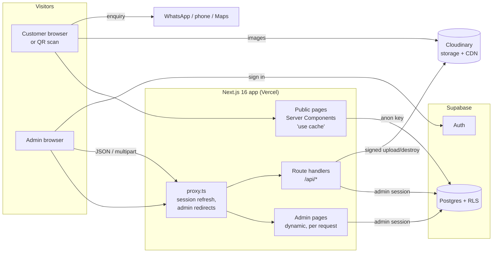
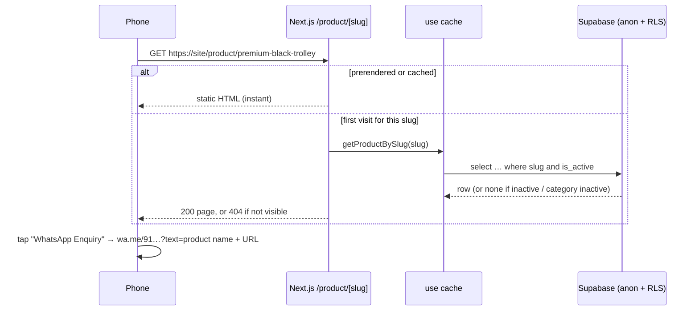

# Architecture

## System overview



There are three kinds of server work:

| Area                  | Supabase client               | Caching                                   | Auth                   |
| --------------------- | ----------------------------- | ----------------------------------------- | ---------------------- |
| Public pages          | `createPublicClient()` (anon, no cookies) | `"use cache"` + tags, prerendered         | none (RLS limits reads) |
| Admin pages           | `createServerSupabase()` (cookie session) | none, rendered per request                | `requireAdmin()`        |
| API route handlers    | `createServerSupabase()` via `guardAdmin()` | none (`Cache-Control: no-store`)          | `guardAdmin()`          |

## Directory layout

```
src/
  proxy.ts                    Next 16 "middleware": session refresh + optimistic admin redirects
  app/
    layout.tsx                <html>, fonts, root metadata (from store settings)
    not-found.tsx             404 for unmatched URLs (with site chrome)
    robots.ts / sitemap.ts    SEO files (sitemap reads cached slugs)
    (site)/                   public route group — shares navbar/footer layout
      layout.tsx  template.tsx  error.tsx  not-found.tsx
      page.tsx                         /
      products/page.tsx                /products
      category/[slug]/page.tsx         /category/:slug
      product/[slug]/page.tsx          /product/:slug
      about/page.tsx  contact/page.tsx
    admin/
      layout.tsx              instant=false, <Toaster/>, noindex metadata
      login/page.tsx          /admin/login (outside the protected group)
      (panel)/                protected group: layout calls requireAdmin()
        page.tsx              dashboard
        products/  categories/  qr/  settings/  account/
    api/                      route handlers (see API.md)
  components/
    ui/          primitives (Button, Container, Skeleton, EmptyState, icons)
    navbar/ footer/ layout/ home/ products/ categories/   public UI
    admin/ forms/ qr/          admin UI (client components)
    shared/      cross-cutting (SmartImage, Reveal, Logo, JSON-LD, contact buttons, map)
  lib/
    env.ts / env.server.ts   public env helpers / server-only secrets
    supabase/    public.ts (anon) · server.ts (cookies) · browser.ts · proxy.ts
    auth/        admin.ts (getAdminStatus, requireAdmin) · safe-redirect.ts
    data/        public.ts (cached reads) · admin.ts · mappers.ts · revalidate.ts · slugs.ts
    api/         http.ts (server: guards, errors) · client.ts (browser: fetch/upload helpers)
    cloudinary/  server.ts (signed upload/destroy) · loader.ts (next/image) · url.ts
    images/      optimize.ts (browser resize + WebP)
    qr/          generate.ts
    validations/ Zod schemas for every input
    utils/       slug, contact links (wa.me / tel:), formatting
  types/index.ts             domain types
supabase/                    migration, seed, demo cleanup
scripts/create-admin.mjs     creates/promotes an admin (service role, local only)
```

### Naming and boundaries

- **`server-only`** is imported by every module that touches secrets or the cookie session
  (`env.server.ts`, `supabase/server.ts`, `supabase/public.ts`, `auth/admin.ts`, `api/http.ts`,
  `cloudinary/server.ts`, `data/*`, `qr/generate.ts`). Importing one from a Client Component
  fails the build.
- **`"use client"`** is used only where interactivity is required (navbar menu, gallery, filters,
  admin forms). Pages and layouts are Server Components.
- Database rows are converted to domain types in `lib/data/mappers.ts`. Components never see raw
  rows; JSONB columns are sanitised there (bad shapes are dropped, not trusted).

## Rendering and caching (Cache Components)

`next.config.ts` enables `cacheComponents` and `partialPrefetching`. That changes the rules
compared with older Next.js — see [DEVELOPMENT.md](DEVELOPMENT.md#nextjs-16--cache-components-rules).

### Public data

Every public read in `src/lib/data/public.ts` is a `"use cache"` function with a tag and a
lifetime:

| Function                   | Tags                     | Normal life | On failure |
| -------------------------- | ------------------------ | ----------- | ---------- |
| `getStoreSettings`         | `store-settings`         | `hours`     | `minutes`  |
| `getActiveCategories`, `getCategoryBySlug` | `categories` | `hours` | `minutes` |
| `searchProducts`, `getFeaturedProducts`, `getNewArrivals`, `getProductBySlug`, `getRelatedProducts`, `getPublicSlugs` | `products`, `categories` | `hours` | `minutes` |

Failures return `{ ok: false }` (or empty data) with a **short** cache life, so a database
hiccup heals itself within minutes instead of being cached for hours. Pages render a friendly
empty/error state for `{ ok: false }`.

### Revalidation

Admin mutations call helpers in `src/lib/data/revalidate.ts`:

| Mutation        | Tags expired                     |
| --------------- | -------------------------------- |
| product         | `products`                       |
| category        | `categories` + `products` (category visibility changes which products are public) |
| store settings  | `store-settings`                 |

They use `revalidateTag(tag, { expire: 0 })` — the next request gets fresh data (no stale
serving). Route handlers can't use `updateTag` (Server Actions only), hence `expire: 0`.

### Route rendering

| Route                    | How it renders                                                                 |
| ------------------------ | ------------------------------------------------------------------------------ |
| `/`, `/about`, `/contact` | Static (all data cached)                                                      |
| `/products`              | Partial prerender: header static; results stream inside `<Suspense>` (reads `searchParams`) |
| `/category/[slug]`, `/product/[slug]` | `ensureStatic = "navigation"` + `generateStaticParams`. Known slugs are prerendered at build; a new slug is rendered **completely** on first request, then cached. Because nothing streams before data is ready, `notFound()` returns a **real HTTP 404**. |
| `/admin/**`              | Dynamic per request (`connection()` in `getAdminStatus`, `instant = false`)    |
| `/api/**`                | Dynamic                                                                         |

`generateStaticParams` must return at least one entry under Cache Components, so when the
database is empty it returns `__placeholder__`, which simply renders the 404 page
(`src/lib/data/static-params.ts`).

Category pages filter **in the browser** (`CategoryBrowser`) over the cached product list, which
keeps the page fully static. `/products` filters **on the server** via URL params so results are
shareable and scale to the full catalogue.

## Key request flows

### Customer scans a product QR in the store



### Admin saves a product (with gallery changes)

```mermaid
sequenceDiagram
  participant UI as ProductForm (browser)
  participant API as PATCH /api/products/:id
  participant DB as Postgres
  participant CL as Cloudinary
  Note over UI: new photos were already optimised<br/>and uploaded via POST /api/upload
  UI->>API: JSON {fields…, images:[{id?}, …]} (ordered)
  API->>API: guardAdmin + Zod validation + unique slug
  API->>DB: rpc save_product(p_id, product, images) — one transaction
  DB-->>API: saved_id, saved_slug, removed_public_ids
  API->>CL: destroy removed assets (after commit; failures logged)
  API->>API: revalidateTag('products', {expire:0})
  API-->>UI: 200 {id, slug}
  UI->>UI: router.refresh() → form remounts with saved image ids
```

`save_product` (see [DATABASE.md](DATABASE.md#save_product)) updates the product, deletes
removed images, re-orders kept images, inserts new ones, and enforces exactly one primary image —
atomically.

### Admin sign-in

1. `LoginForm` calls `supabase.auth.signInWithPassword` in the browser (anon key).
2. It calls `rpc('is_admin')`; non-admins are signed out immediately with a clear message.
3. `@supabase/ssr` stores the session in cookies; `proxy.ts` refreshes it on later requests.
4. Every admin page/API re-verifies via `getAdminStatus()` (JWT verified with `getClaims()` +
   `admin_users` lookup).

## UI system

- Tokens live in `src/app/globals.css` (`@theme`): `ink #111111`, `gold #C9972B`,
  `gold-deep #8A6418` (accessible gold for text on light), `cream #F7F5F0`, `paper #FFFFFF`,
  `muted #666666`, `line #E4DFD5`. Gold is an accent only.
- Fonts: Playfair Display (`font-display`) for headings, Inter (`font-sans`) for UI.
- Motion: Framer Motion via `LazyMotion` + `domAnimation` with `MotionConfig reducedMotion="user"`;
  page transitions are CSS-only (`template.tsx`) so they never delay first paint. All animation
  is disabled under `prefers-reduced-motion`.
- Images: `next/image` with a global Cloudinary loader (`src/lib/cloudinary/loader.ts`);
  `SmartImage` falls back to line-art bag illustrations when an image is missing or broken.

## Configuration surface

- **Environment variables** — see the root README. Missing values degrade gracefully.
- **Store settings** (`store_settings` table, edited in Admin → Store Information) — the single
  source for name, phones, WhatsApp, address, Instagram, Maps, logo, favicon. Components must
  read these via `getStoreSettings()`, never hard-code business details.
