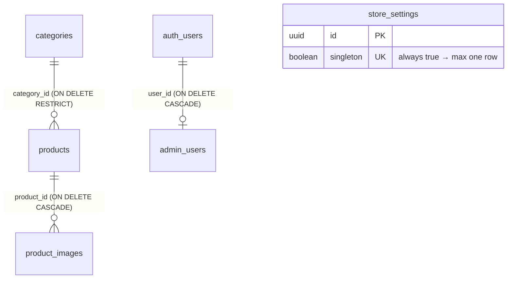

# Database

Supabase Postgres. The full schema lives in
[`supabase/migrations/20261012000000_initial_schema.sql`](../supabase/migrations/20261012000000_initial_schema.sql).

## Entity relationships



## Tables

### `categories`

| Column            | Type          | Notes                                              |
| ----------------- | ------------- | -------------------------------------------------- |
| `id`              | uuid PK       | `gen_random_uuid()`                                |
| `name`            | varchar(120)  | required, non-blank                                |
| `slug`            | varchar(140)  | unique, `^[a-z0-9]+(-[a-z0-9]+)*$`                 |
| `description`     | text          |                                                    |
| `image_url`       | text          | Cloudinary secure URL                              |
| `image_public_id` | text          | Cloudinary public id (for cleanup)                 |
| `is_active`       | boolean       | default `true`; inactive hides category + its products publicly |
| `sort_order`      | integer       | default `0`, ascending                             |
| `created_at` / `updated_at` | timestamptz | `updated_at` maintained by trigger       |

### `products`

| Column              | Type     | Notes                                                        |
| ------------------- | -------- | ------------------------------------------------------------ |
| `id`                | uuid PK  |                                                              |
| `name`              | varchar(160) | required                                                 |
| `slug`              | varchar(180) | unique, same pattern as categories; used in `/product/:slug` and QR codes |
| `category_id`       | uuid FK  | `→ categories.id`, **ON DELETE RESTRICT**                    |
| `short_description` | text     | shown on cards                                               |
| `description`       | text     |                                                              |
| `features`          | jsonb    | array, default `[]` — `[{ "label": "Material", "value": "ABS" }]` |
| `specifications`    | jsonb    | object, default `{}` — `{ "lock_type": "TSA Lock" }` (keys snake_case; UI humanises them) |
| `available_colors`  | jsonb    | array, default `[]` — `[{ "name": "Black", "hex": "#111111" }]` (`hex` optional) |
| `is_featured`       | boolean  | homepage Featured Collection                                 |
| `is_new_arrival`    | boolean  | homepage New Arrivals                                        |
| `is_active`         | boolean  | inactive → hidden publicly, URL returns 404                  |
| `sort_order`        | integer  |                                                              |
| `created_at` / `updated_at` | timestamptz | trigger-maintained `updated_at`                  |

`CHECK` constraints enforce the JSON types (`jsonb_typeof`).

### `product_images`

| Column                 | Type    | Notes                                         |
| ---------------------- | ------- | --------------------------------------------- |
| `id`                   | uuid PK |                                               |
| `product_id`           | uuid FK | **ON DELETE CASCADE**                         |
| `cloudinary_public_id` | text    | required                                      |
| `image_url`            | text    | required (Cloudinary `secure_url`)            |
| `alt_text`             | text    |                                               |
| `width`, `height`      | integer |                                               |
| `format`               | text    | normally `webp`                               |
| `sort_order`           | integer | gallery order                                 |
| `is_primary`           | boolean | used on product cards                         |

Constraints:

- `product_images_one_primary_per_product` — partial unique index on `(product_id) WHERE is_primary`:
  **at most one** primary image per product, enforced by the database.
- `product_images_unique_asset_per_product` — unique `(product_id, cloudinary_public_id)`.

### `store_settings`

Single row (`singleton boolean unique check (singleton)`), seeded by the migration with the
store's details. Columns: `store_name, owner_name, phone_primary, phone_secondary,
whatsapp_number, address, city, state, pincode, instagram_url, google_maps_url, logo_url,
favicon_url, established_on, updated_at`.

`whatsapp_number` falls back to `phone_primary` in the app when empty.

### `admin_users`

`user_id uuid PK → auth.users(id) ON DELETE CASCADE`, `created_at`. Membership = admin.
No API policy allows writing it; add admins with `npm run admin:create` or SQL.

## Indexes

Slugs are indexed by their unique constraints. Additional indexes:
`products(category_id)`, `products(is_active)`, partial `products(is_featured)` and
`products(is_new_arrival)`, `products(is_active, sort_order, created_at desc)`,
`categories(is_active, sort_order)`, `product_images(product_id, sort_order)`.

## Row Level Security

RLS is enabled on every table.

| Table            | `anon` / `authenticated` SELECT                                   | INSERT / UPDATE / DELETE |
| ---------------- | ----------------------------------------------------------------- | ------------------------ |
| `categories`     | `is_active OR is_admin()`                                         | `is_admin()`             |
| `products`       | `is_admin() OR (is_active AND its category is active)`            | `is_admin()`             |
| `product_images` | only if the parent product is visible to the caller               | `is_admin()`             |
| `store_settings` | everyone                                                          | `is_admin()` (no delete) |
| `admin_users`    | own row only                                                      | nobody via API           |

Consequences worth knowing:

- Deactivating a **category** hides all its products publicly without touching the products.
- The public site needs no `is_active` filtering for correctness — RLS already does it (the code
  still filters explicitly for clarity and index use).

## Functions

### `is_admin()`

`SECURITY DEFINER`, `search_path = ''`. Returns whether `auth.uid()` is in `admin_users`.
Executable by `anon` and `authenticated` (policies call it).

### `save_product`

```sql
save_product(p_id uuid, p_product jsonb, p_images jsonb)
  returns table (saved_id uuid, saved_slug text, removed_public_ids text[])
```

`SECURITY INVOKER` (RLS applies) and explicitly raises `42501` for non-admins. In one transaction:

1. Inserts (`p_id` null) or updates the product (`P0002` if the id doesn't exist).
2. Deletes images of this product that are not in `p_images` (by `id`) and returns their
   Cloudinary public ids.
3. Clears all primary flags, then walks `p_images` **in order**: existing images (with `id`) get
   `sort_order` = position and new `alt_text`; new images are inserted.
4. Primary image = the one flagged `is_primary`, otherwise the first image.

Called by `POST /api/products` and `PATCH /api/products/:id`. Executable by `authenticated` only.

## Seed and demo data

- `supabase/seed.sql` — the three launch categories plus four products named **`DEMO – …`**
  (slugs start with `demo-`). Optional, idempotent (`on conflict do nothing`).
- `supabase/remove-demo-data.sql` — deletes `products where slug like 'demo-%'`. Categories stay.

## Changing the schema

1. Add a **new** migration file in `supabase/migrations/` (timestamp prefix); never edit an
   applied one in production.
2. Apply with the Supabase SQL editor or `supabase db push`.
3. Update `src/types/index.ts`, `src/lib/data/mappers.ts`, the Zod schema in
   `src/lib/validations/`, and (for products) `save_product`.
4. If public visibility changes, update the RLS policies and re-run the checks in
   [SECURITY.md](SECURITY.md#verifying-rls).

## Useful SQL

```sql
-- Who are the admins?
select u.email from public.admin_users a join auth.users u on u.id = a.user_id;

-- Revoke an admin
delete from public.admin_users
where user_id = (select id from auth.users where email = 'person@example.com');

-- Products without images
select p.name from public.products p
where not exists (select 1 from public.product_images i where i.product_id = p.id);
```
