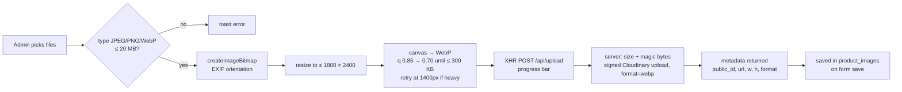

# Images & QR codes

## Image pipeline



- Implementation: `src/lib/images/optimize.ts` (browser), `src/lib/api/client.ts`
  (`uploadImageWithProgress`), `src/app/api/upload/route.ts`, `src/lib/cloudinary/server.ts`.
- Two files are processed at a time to keep phones responsive.
- Browsers that cannot encode WebP fall back to JPEG; Cloudinary converts to WebP on upload
  (`format: "webp"`), so storage is always WebP.
- Transparent PNGs are flattened onto white.
- The original file never leaves the device.

### Cloudinary layout

```
sachdeva-carry-hub/
  products/<category-slug>/     product photos (folder from the selected category)
  products/uncategorized/       if no category chosen yet
  categories/
  branding/                     logo & favicon uploads
```

### Delivery

`next/image` uses a global loader (`src/lib/cloudinary/loader.ts`) that rewrites Cloudinary URLs
to `…/upload/f_auto,q_auto,c_limit,w_<width>/…`. Cloudinary serves AVIF/WebP at the right size
from its CDN; Vercel's image optimiser is not used. Non-Cloudinary URLs pass through unchanged.

Other transformations via `cloudinaryTransform()` (`src/lib/cloudinary/url.ts`):
Open Graph images (`f_jpg,c_fill,w_1200,h_630`) and the favicon (`f_png,c_fill,w_64,h_64`).

### Fallbacks

`SmartImage` (`src/components/shared/smart-image.tsx`) renders a line-art bag illustration
(trolley / backpack / handbag, picked from the category slug) when the URL is missing **or**
fails to load. The product gallery does the same per image.

### Cleanup rules

| Event                                         | Cloudinary asset                                          |
| --------------------------------------------- | --------------------------------------------------------- |
| Image removed **before** saving / form cancelled | deleted immediately via `DELETE /api/upload`          |
| Image removed and product **saved**           | deleted after the DB transaction commits                  |
| Product deleted                               | all its assets deleted after the row is deleted           |
| Category image replaced/removed and saved     | old asset deleted                                         |
| Cloudinary delete fails                       | logged server-side (`[cloudinary:destroy]`); DB stays correct |
| Browser closed mid-upload                     | asset may be orphaned — clean up in the Cloudinary console if needed |

DB-first ordering means a Cloudinary failure can leave an unused file, but never a live product
pointing at a missing image.

## Gallery behaviour (public)

`src/components/products/product-gallery.tsx`: primary image first in admin order; thumbnails;
prev/next buttons; ← → keys; swipe on touch devices (Framer Motion drag); hover-zoom (2×, follows
the cursor) on devices with a fine pointer; image counter announced to screen readers.

## QR codes

- Generated on demand by `src/lib/qr/generate.ts` (`qrcode` package) — **never stored**.
- Content: absolute URL from `NEXT_PUBLIC_SITE_URL` (`/product/<slug>` or `/`). Only http(s) URLs
  are encoded; if the site URL is missing the API returns `503` and the admin page shows a
  configuration error instead of a broken code.
- Options: error correction **Q** (survives scuffed stickers), 2-module quiet zone, `#111111` on
  white. PNG 1024 px; SVG scalable.
- Admin → QR Codes (`src/components/qr/`): preview, copy link, download PNG/SVG, print. Printing
  writes a clean label (QR + name + URL, fixed physical size: 60 mm product, 70 mm website) into a
  hidden iframe and calls the browser print dialog.

### Rules of thumb for stickers

- Generate codes **after** the production domain is set in `NEXT_PUBLIC_SITE_URL`.
- Changing a product's **slug** changes its URL — reprint its sticker (the form warns).
- Deactivating a product makes its QR show the not-found page until reactivated; deleting it
  breaks the code permanently. Prefer deactivating.
- Minimum printed size ~2 cm; test-scan one sticker before printing a batch.
